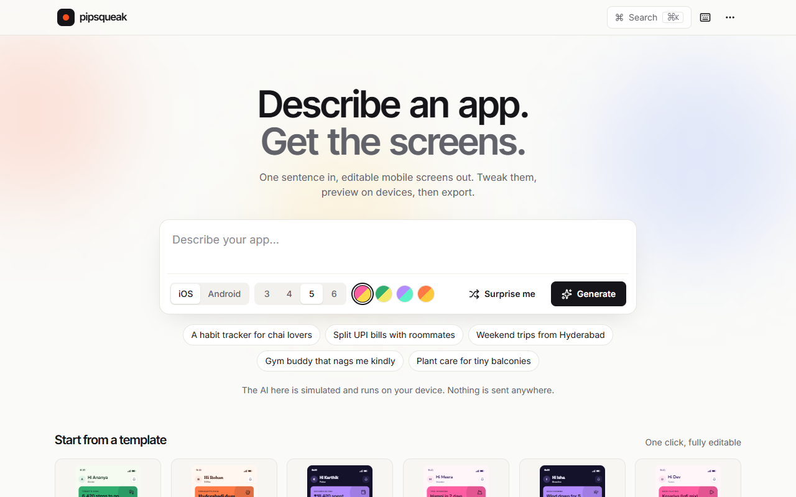
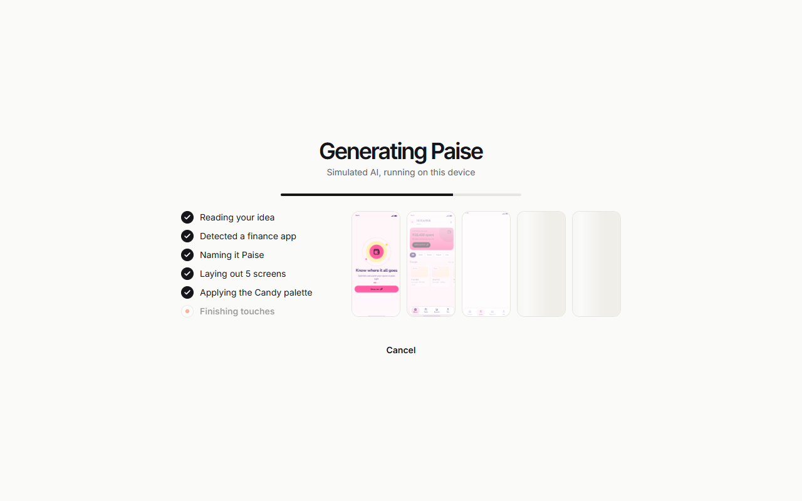
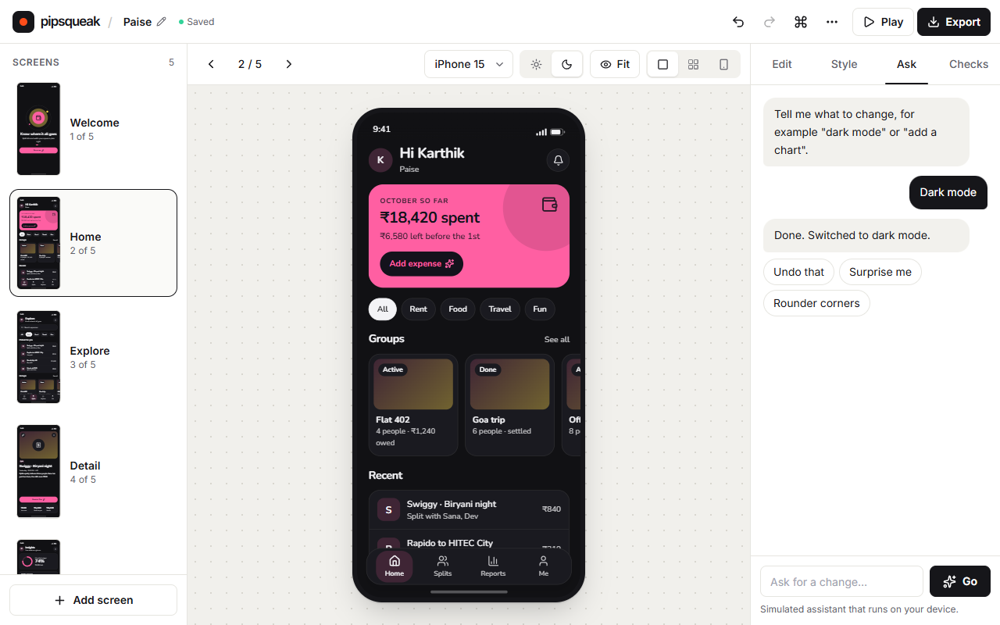
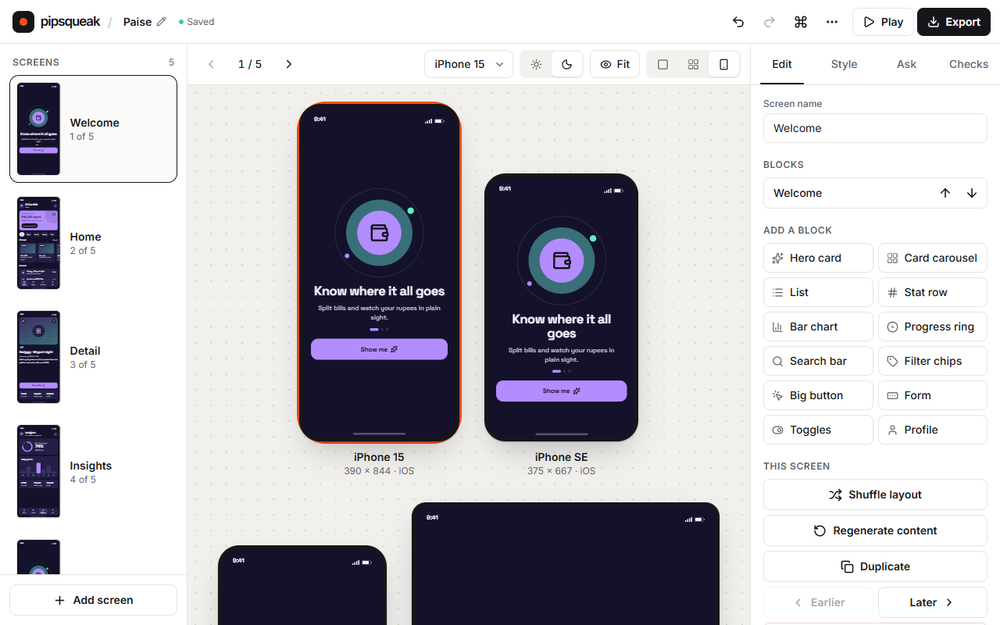
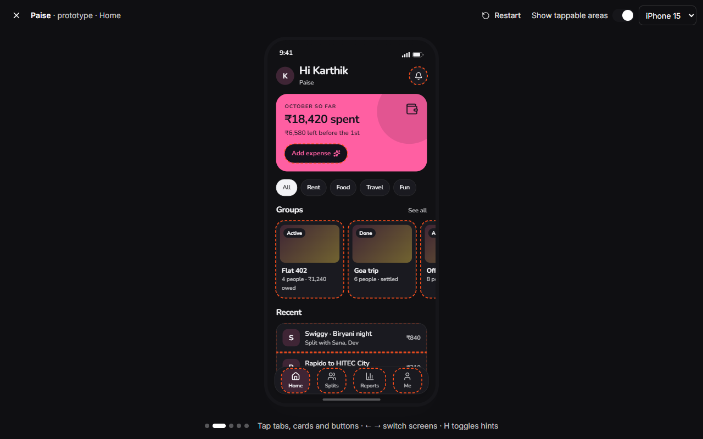
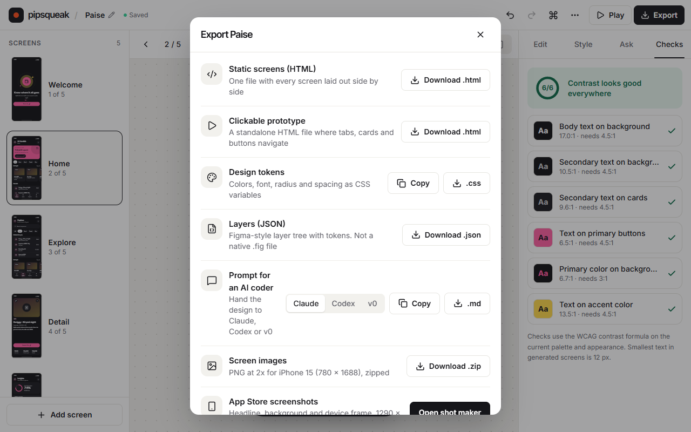
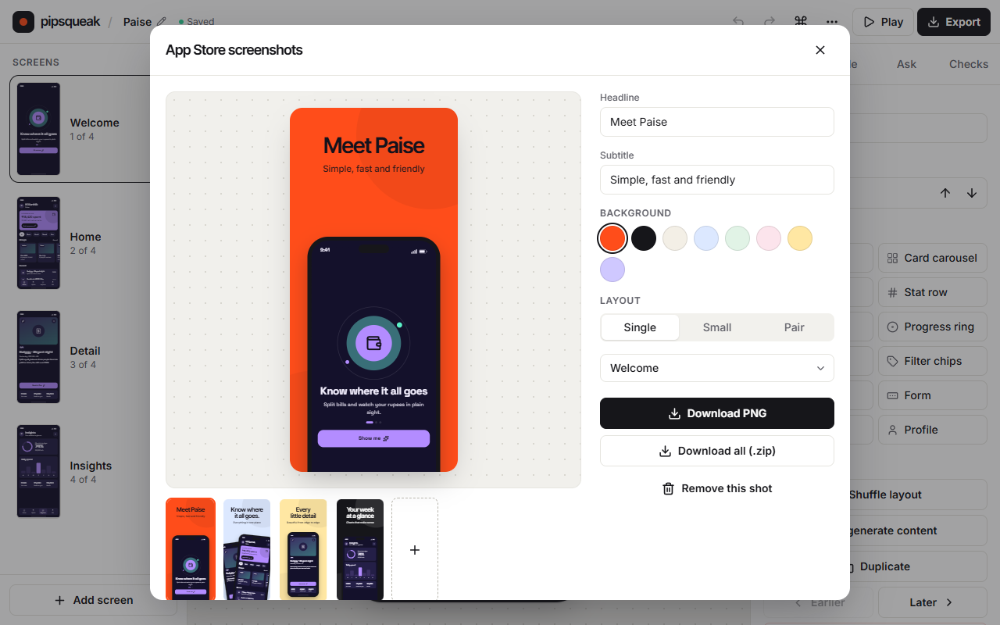

<div align="center">


# Describe an app. Get the screens.

**Pipsqueak turns one sentence into editable mobile app screens.** Tweak them, preview them on devices, click through a prototype, then export to HTML, PNG, design tokens or a prompt for your AI coder.

<br />


<br />



</div>

<br />

## ✨ What it does

Type something like *“Split UPI bills with roommates”* and Pipsqueak:

1. **Reads your idea.** It detects the kind of app (finance, food, fitness, travel, and more).
2. **Names it.** For example, *Paise*.
3. **Lays out 3–6 screens:** Welcome, Home, Explore, Detail, Insights and Profile.
4. **Styles it** with a palette, a font and a corner radius that fit the vibe.
5. **Drops you into the Studio**, where every block is editable.

<div align="center">

</div>

> [!NOTE]
> The “AI” is **simulated and runs entirely in your browser**. No API keys, no network calls, nothing sent anywhere. Your projects are saved in `localStorage`.

<br />

## 🎨 The Studio

<div align="center">

</div>

<br />

| | |
|---|---|
| 🧱 **Block editor** | Click any block on the phone to edit its text, icons and values. Add from 12 block types: hero card, card carousel, list, stat row, bar chart, progress ring, search bar, filter chips, big button, form, toggles and profile. |
| 🗂️ **Screens panel** | Drag to reorder, duplicate, shuffle a layout, regenerate content, or add new screens. |
| 🖌️ **Style** | 8 palettes (Candy, Matcha, Blueberry, Sunset, Midnight, Ocean, Cherry, Mono Pop), 4 fonts (Clean, Rounded, Techy, Editorial), a corner-radius slider, density, and light/dark mode. You can also **pull colors from any image**. |
| 💬 **Ask** | Plain-English edits: *“dark mode”*, *“add a chart”*, *“rounder corners”*, *“use a serif font”*, *“rename to Boba”*, *“surprise me”*. |
| ✅ **Checks** | WCAG contrast checks on every text/background pair, with one-click fixes, plus previews for protanopia, deuteranopia, tritanopia and grayscale. |
| 🕰️ **History** | Undo/redo for every edit, plus a version history you can jump back to. |
| 🔀 **Variations** | Explore alternative styles for a screen side by side. |

<br />

## 📱 Preview everywhere

Switch between **one screen**, **all screens** and **compare devices**: iPhone 15, iPhone SE, Pixel 8 and a tablet. Each has the right size and platform (iOS or Android) chrome.

<div align="center">

</div>

<br />

## ▶️ Clickable prototype

Press <kbd>P</kbd> to play the app. Tabs, cards and buttons navigate between screens with native-feeling push transitions. Toggle **Show tappable areas** to see every hotspot.

<div align="center">

</div>

<br />

## 📦 Export

<table>
<tr>
<td width="55%">

</td>
<td>

- **Static screens (HTML):** every screen side by side in one file
- **Clickable prototype (HTML):** a standalone file you can share
- **Design tokens (CSS):** colors, font, radius and spacing as variables
- **Layers (JSON):** a Figma-style layer tree with tokens
- **Prompt for an AI coder:** tuned for Claude, Codex or v0
- **Screen images:** 2× PNGs, zipped
- **App Store screenshots:** headline, background and device frame

</td>
</tr>
</table>

### App Store shot maker

Pick a headline, subtitle, background and layout (single, small or a tilted pair), then download one PNG or all of them as a zip.

<div align="center">

</div>

<br />

## 🚀 Quick start

```bash
git clone https://github.com/KoushikNavuluri/pipsqueak.git
cd pipsqueak
npm install
npm run dev
```

Then open **http://localhost:5173**.

| Command | What it does |
|---|---|
| `npm run dev` | Start the dev server with hot reload |
| `npm run build` | Build a production bundle into `dist/` |
| `npm run preview` | Serve the production build locally |

<br />

## ⌨️ Keyboard shortcuts

| Action | Keys |
|---|---|
| Command palette | <kbd>⌘</kbd>/<kbd>Ctrl</kbd> + <kbd>K</kbd> |
| Generate (home page) | <kbd>⌘</kbd>/<kbd>Ctrl</kbd> + <kbd>↵</kbd> |
| Play clickable prototype | <kbd>P</kbd> |
| Undo / redo | <kbd>⌘</kbd> + <kbd>Z</kbd> / <kbd>⇧</kbd> + <kbd>⌘</kbd> + <kbd>Z</kbd> |
| Previous / next screen | <kbd>←</kbd> <kbd>→</kbd> |
| Delete selected block | <kbd>Delete</kbd> |
| Deselect | <kbd>Esc</kbd> |

<br />

## 🧭 Project structure

```
src/
├── main.jsx            # Entry point
├── App.jsx             # Shell: view transitions, dialogs, error boundary
├── store.jsx           # State, reducer, undo/redo history, localStorage persistence
├── data.js             # Palettes, fonts, vibes, app categories, templates, devices
├── gen.js              # The “simulated AI” that turns a prompt into a project
├── ai.js               # The Ask assistant: plain-English edit commands
├── render.jsx          # Renders screens, blocks, status bars and tab bars
├── play.jsx            # Clickable prototype player
├── exporters.jsx       # HTML, prototype, tokens, JSON, prompt and PNG exports
├── dialogs.jsx         # Export, App Store shots, variations, history, shortcuts
├── palette.jsx         # Command palette
├── imagecolors.js      # Pulls a palette out of an uploaded image
├── icons.jsx           # Icon registry (lucide)
├── ui.jsx              # Buttons, segmented controls, menus, toasts, confetti
├── index.css           # Compiled styles
└── screens/
    ├── Home.jsx        # Prompt box, templates, your projects
    ├── Generating.jsx  # The step-by-step generation screen
    └── Studio.jsx      # The editor
```

<br />

## 🛠️ Built with

- **[React 18](https://react.dev)** and **[Vite](https://vitejs.dev)**
- **[Framer Motion](https://motion.dev)** for transitions, layout animations and drag-to-reorder
- **[Lucide](https://lucide.dev)** icons
- **[html-to-image](https://github.com/bubkoo/html-to-image)** for PNG exports, and **[fflate](https://github.com/101arrowz/fflate)** for zipping them

<br />

## 📝 About this repo

Pipsqueak started as a single, self-contained `pipsqueak.html` build (still included in the repo root). This repository rebuilds that file as a regular React project, split into modules, with the same layout, styling, interactions and exports.

The rebuild was checked side by side against the original. Screens matched pixel for pixel, and exported files were byte-identical. The styles in `src/index.css` are the original compiled Tailwind output, which is why there is no Tailwind config.

<br />

<div align="center">

**One sentence in. Screens out.** ✦

</div>
