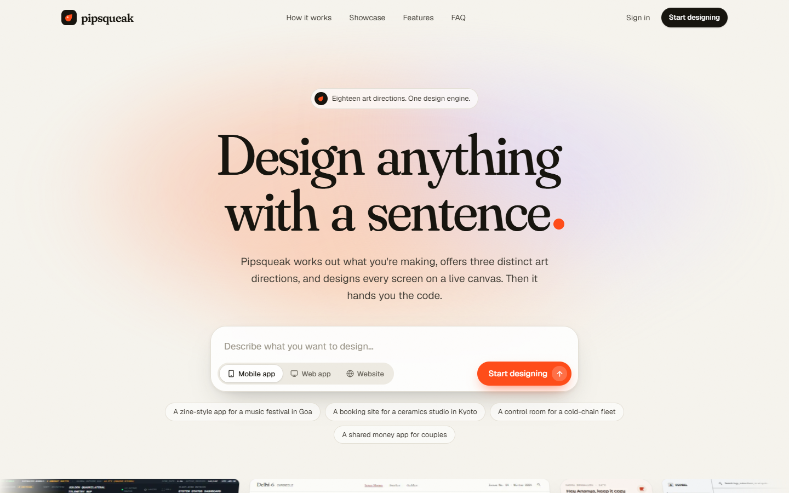
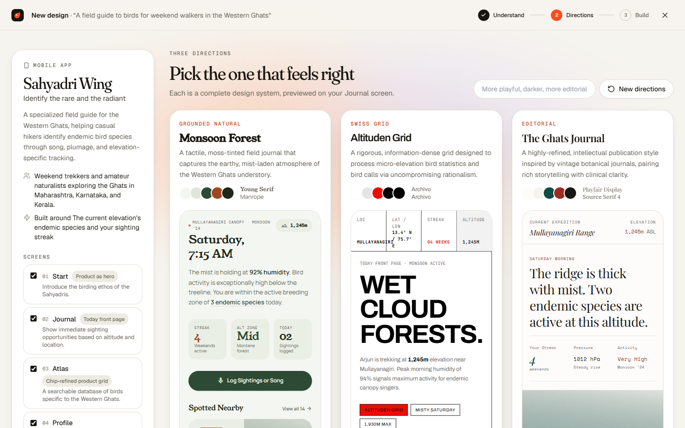
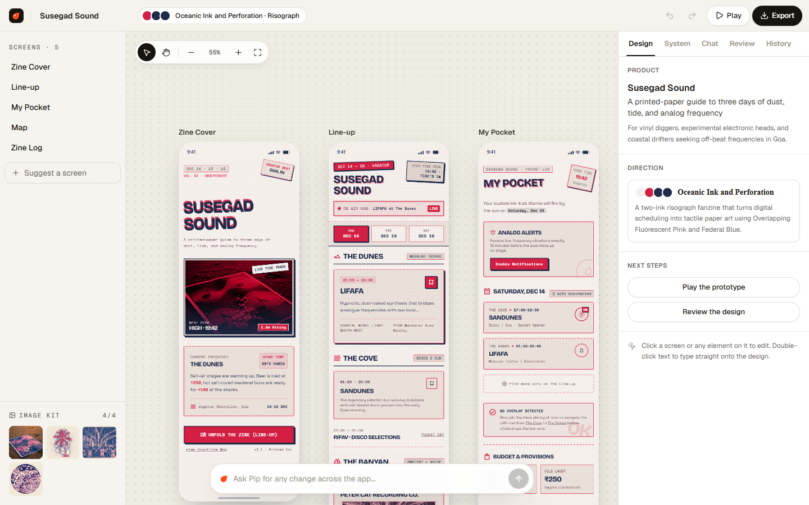
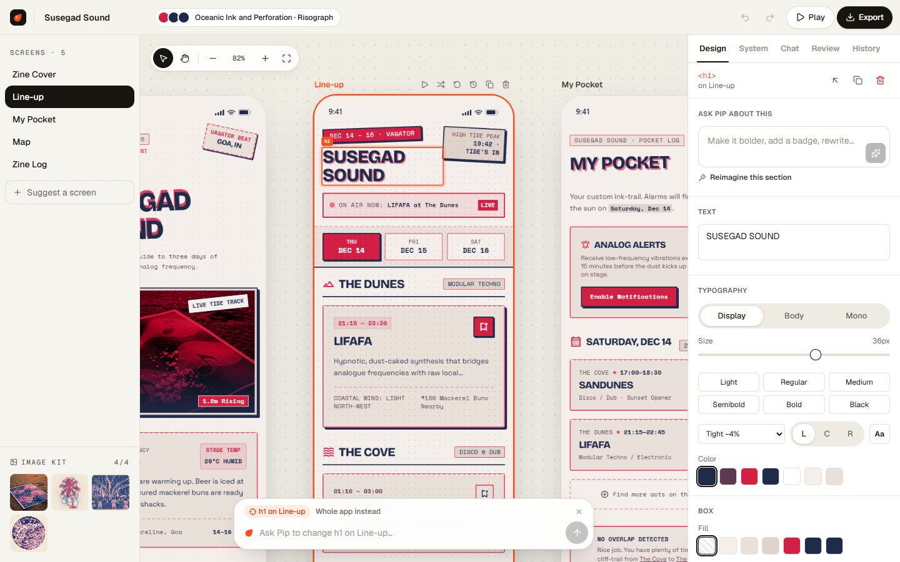
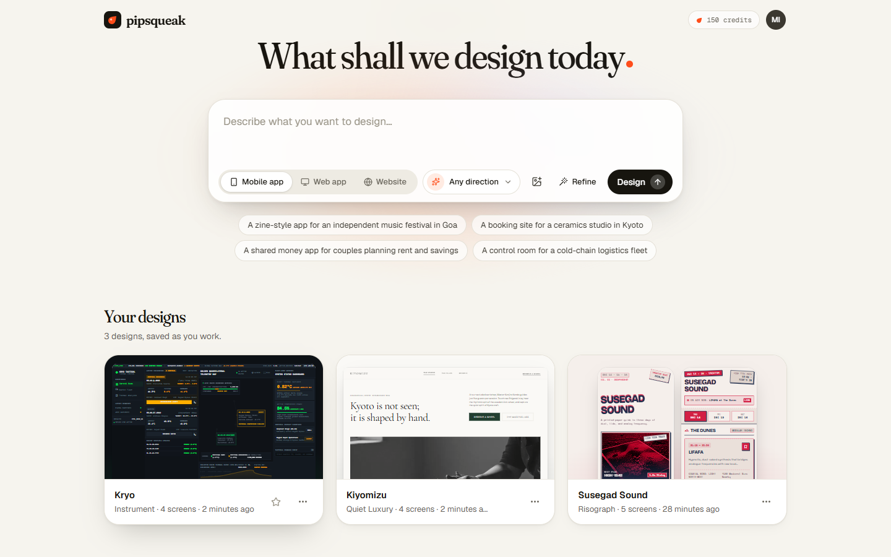

<div align="center">


# Pipsqueak

**Design anything with a sentence.**

Pipsqueak works out what you're making, offers three distinct art directions, designs every screen on a live canvas, and hands you a React project you can ship.

<br />



</div>

<br />

## What it does

Describe a mobile app, a web app or a website in one sentence. You can attach a sketch, a screenshot or a moodboard too. Pipsqueak then:

1. **Understands the product.** It names it, decides who it's for and what the main screen is built around, and maps the screens. Each screen gets its own composition, so no two share a layout.
2. **Offers three directions.** Each is a complete design system: type pairing, color strategy (with contrast checked and repaired), shape, icons, imagery and motion. They come from 18 art directions, such as Editorial, Swiss Grid, Quiet Luxury, Raw Brutalism, Risograph and Instrument, and are previewed side by side on your own main screen.
3. **Designs every screen on a canvas.** Once you choose a direction, the rest of the product is designed in parallel in that system. The screens share navigation, link to each other, and use an image kit painted in the direction's style.
4. **Lets you refine anything.** Select an element and ask Pip, the built-in design partner, to change it, or edit its properties by hand. Pip can also make changes across the whole app.

<div align="center">

<br /><br />

</div>

<br />

## The studio

| | |
|---|---|
| 🗺️ **Infinite canvas** | Every screen at full length, side by side. Scroll or drag to pan, <kbd>⌘</kbd>/<kbd>Ctrl</kbd> + scroll to zoom. Web designs switch between desktop, tablet and phone widths. |
| 🎯 **Select to edit** | Click any element to edit its text, typeface, size, weight, tracking, color, fill, corners and padding, or ask Pip to change only that element. Double-click text to type on the design. |
| 🧬 **Living design system** | Change a color, typeface, radius or icon style and every screen follows, with live contrast ratios. Switch to one of the other two directions at any time. |
| 💬 **Pip** | Ask for changes across the app: “Add a notifications screen”, “Make it darker”. Pip plans the change, then restyles, adds screens and reworks existing ones, and shows a checklist of what it did. |
| 🔀 **Variations** | Three alternatives of any screen, side by side: refine, explore or reimagine. |
| 🔍 **Review** | Rendered checks on every screen (contrast, tiny text, tap targets, overflow) plus a critique of craft, hierarchy, consistency, originality and copy, each issue with a fix. |
| 🕰️ **Versions** | Every change is kept. Compare any version with the current one, restore it, or undo and redo. |
| ▶️ **Prototype** | Press <kbd>P</kbd> to tap through the product. Tap something that isn't linked yet and Pip offers to design the screen it should open. |

<div align="center">

</div>

<br />

## Export

- **React + Tailwind project:** a Vite app with every screen as a component, the design system as Tailwind v4 tokens and working navigation. It builds and runs as-is.
- **Clickable HTML prototype:** one page per screen plus an index.
- **DESIGN.md:** the design system as tokens and rules, for designers and coding agents.
- **Tailwind tokens** and any screen's HTML.

## Showcase

The landing page and dashboard feature real designs made by Pipsqueak from a single sentence, stored in [`public/showcase`](public/showcase). Remix any of them into your account from the dashboard.

## Your account

Email and password sign-in, designs saved to your account as you work, and a Settings page for profile, email and password, design defaults, a brand voice Pip applies to every design, daily usage, export and import, signing out everywhere, and deleting your account. Row-level security keeps every user's data private.

<div align="center">

</div>

<br />

## How it works

```
Browser ──(session token)──▶ Supabase Edge Function "ai" ──▶ model API
   ▲                              │  verifies the user
   │   streamed screens (SSE)     │  enforces the daily credit quota
   └──────────────────────────────┘  logs every run, retries on capacity errors
```

- **Staged, not one-shot.** The engine in `src/design/` runs separate stages for understanding, design systems, screens, edits, plans and critique. Each stage has its own prompt in `supabase/functions/ai/design.ts`.
- **Guarantees that don't depend on the model.** Text and on-color contrast are repaired with the hue kept. Off-system colors are mapped back onto tokens. Invalid size classes and text under 11px are fixed. Every screen shares one navigation.
- **Screens are HTML and Tailwind CSS v4**, styled only through design tokens, rendered in sandboxed iframes. A token change restyles every screen live.
- **The model key never reaches the browser.** It's a Supabase secret used only by the Edge Function.
- **Quotas.** Each account gets 150 credits a day. Images cost 2 and every other step 1. Failures are free. A complete design with its image kit uses about 20.

## Quick start

You need **Node 18+** and a **[Supabase](https://supabase.com)** project.

```bash
git clone https://github.com/KoushikNavuluri/pipsqueak.git
cd pipsqueak
npm install
```

**1. Set up Supabase** with the [Supabase CLI](https://supabase.com/docs/guides/cli):

```bash
supabase login
supabase link --project-ref <your-project-ref>
supabase db push        # tables, row-level security, storage, run log
supabase config push    # auth settings from supabase/config.toml
```

**2. Deploy the design engine.** It needs a Vertex AI express-mode API key, stored as a secret:

```bash
supabase secrets set GEMINI_API_KEY=<your-key> AI_DAILY_LIMIT=150
supabase functions deploy ai --use-api --no-verify-jwt
```

**3. Add your keys.** Copy `.env.example` to `.env.local` and fill in your project URL and publishable key (Supabase dashboard → Settings → API).

**4. Run it:**

```bash
npm run dev
```

Then open **http://localhost:5173**.

| Command | What it does |
|---|---|
| `npm run dev` | Start the dev server |
| `npm run build` | Build for production into `dist/` |
| `npm run preview` | Serve the production build |
| `npm run catalog` | Regenerate the Edge Function's catalog after editing directions, patterns or typefaces |

## Project structure

```
src/
├── main.jsx, App.jsx    # Entry, routes (lazy-loaded), error boundary
├── brand.jsx            # Mark, wordmark, aura, loaders
├── ui.jsx               # Buttons, segmented controls, menus, dialogs, toasts
├── store.jsx            # State, undo and redo, saving to Supabase
├── session.jsx          # Auth session, profile, route guards
├── showcase.jsx         # Showcase cards, viewer and remixing
├── pages/               # Landing, sign in and up, dashboard, settings, 404
├── studio/              # Creation flow and the canvas studio
│   ├── CreateFlow.jsx   # Understand → three directions → build
│   ├── CanvasStudio.jsx # Canvas, screens, prompt bar and panels
│   ├── useStudio.js     # Build queue, edits, Pip, review, image kit
│   └── panels/          # Inspector, design system, chat, review, history
├── design/              # The design engine
│   ├── engine.js        # Stages: understand, systems, screens, edits, plans, critique, imagery
│   ├── skills.js        # 18 art directions
│   ├── patterns.js      # 42 composition patterns
│   ├── system.js        # Design systems, contrast repair, DESIGN.md
│   ├── lint.js          # Keeps generated HTML on the tokens
│   ├── frameDoc.js, bridge.js, htmlTools.js
│   └── exportDesign.js  # React project, HTML prototype, tokens
└── ai/                  # Calls to the Edge Function, image attachments
supabase/
├── functions/ai/        # The Edge Function: handler, stage prompts, catalog
└── migrations/          # Tables, row-level security, storage, run log
public/showcase/         # Showcase designs: images, index and remixable projects
```

## Built with

[React 18](https://react.dev), [Vite](https://vitejs.dev), [React Router](https://reactrouter.com), [Tailwind CSS](https://tailwindcss.com), [Framer Motion](https://motion.dev), [Lucide](https://lucide.dev), [fflate](https://github.com/101arrowz/fflate) and [Supabase](https://supabase.com). Typeset in Fraunces and Geist.

<br />

<div align="center">

**One sentence in. A designed product out.**

</div>
